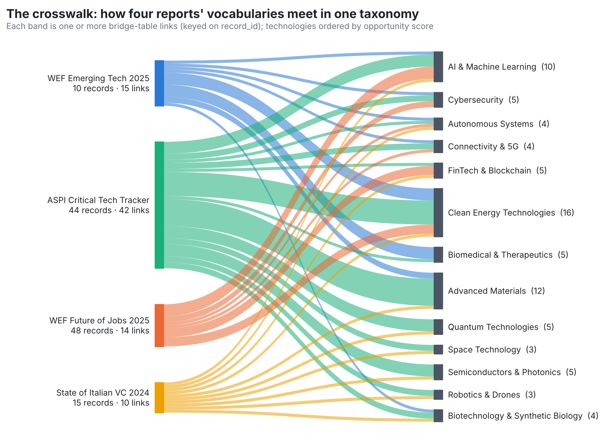
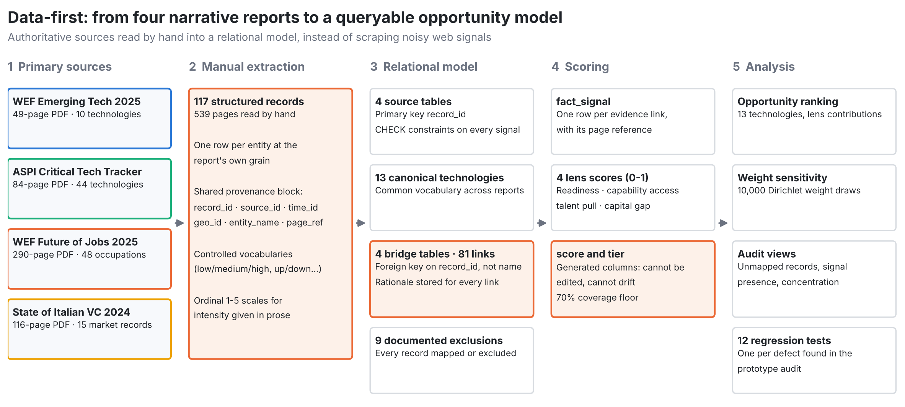
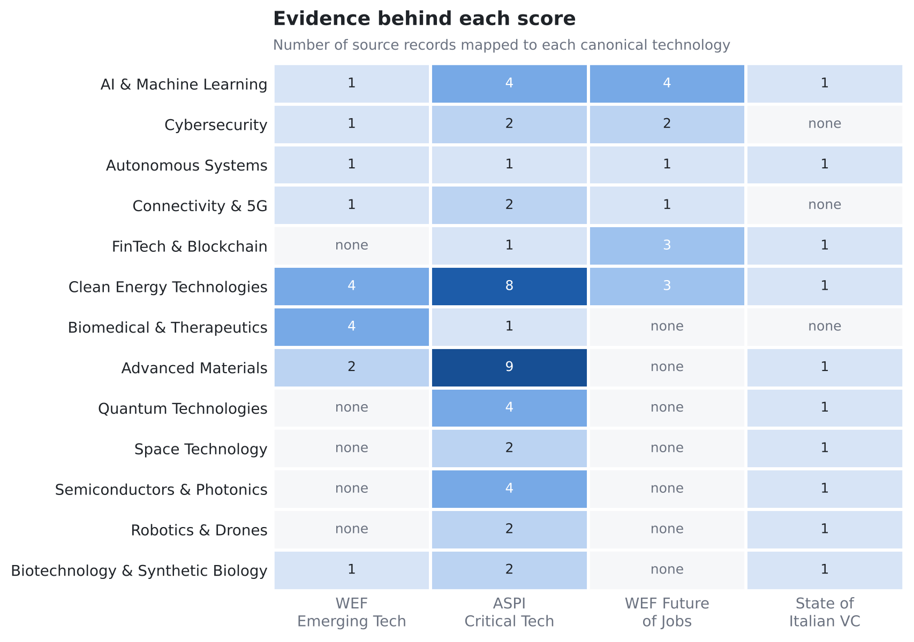
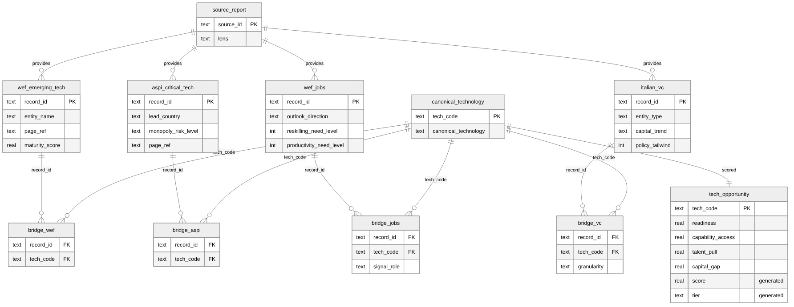
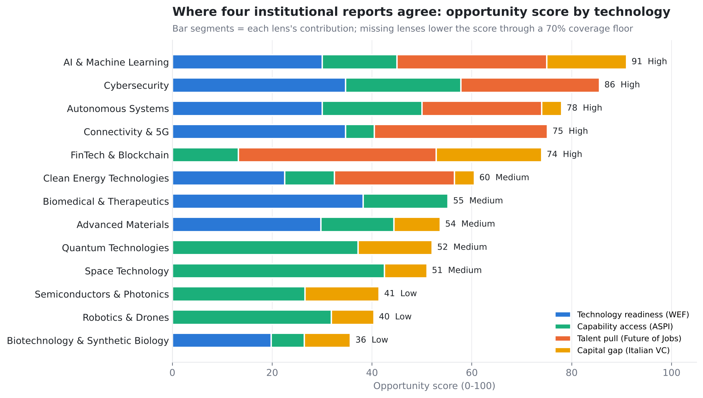
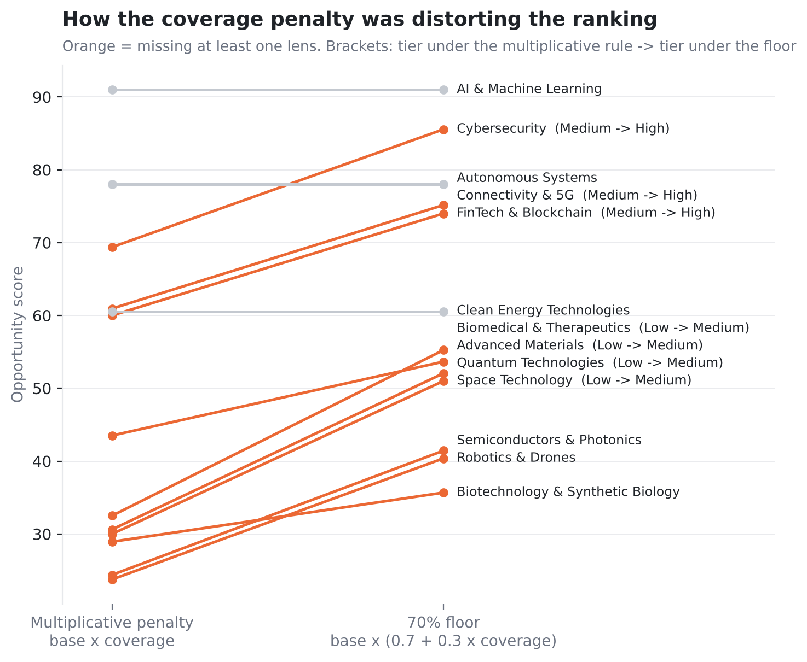
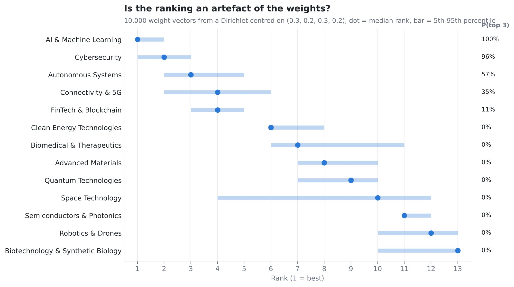
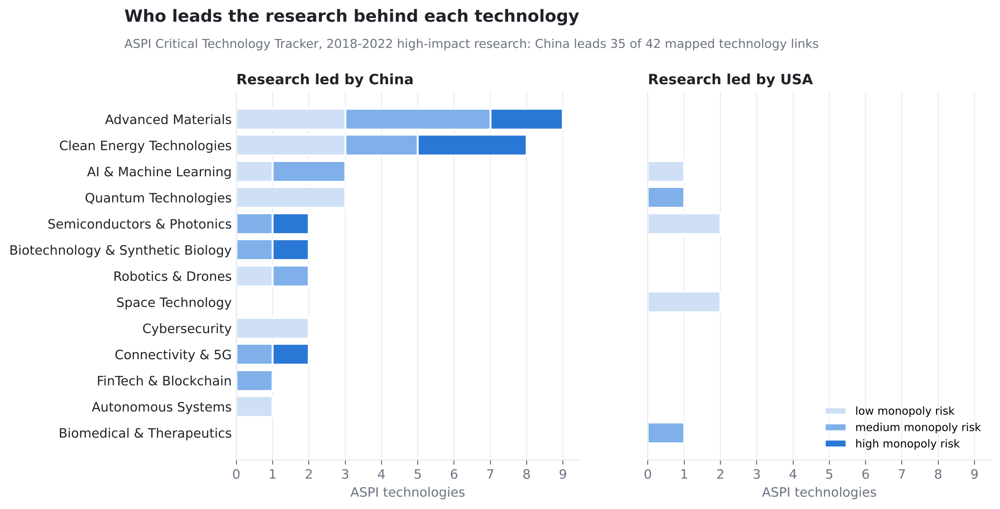

# Integrating Four Institutional Reports into a Relational Model of Technology Opportunity in Italy

**Research question:** If technology readiness, research leadership, labour-market demand and Italian venture capital are read side by side, which technologies show the strongest case for a new venture in Italy, and how much of that ranking survives changes in the assumptions?

**Completed:** December 2025 to April 2026 (internship at Venture Bottega), rebuilt as an independent study November 2026 · **Data:** 117 records extracted by hand from WEF Top 10 Emerging Technologies 2025, ASPI Critical Technology Tracker, WEF Future of Jobs 2025 and State of Italian VC 2024 · **Methods:** data-first extraction from unstructured reports, relational data modelling, semantic crosswalk with bridge tables, SQL generated columns and integrity constraints, weighted multi-criteria scoring with a coverage floor, Dirichlet weight-sensitivity analysis



## Key findings

- **AI & Machine Learning ranks first (91/100) under every one of 10,000 weight vectors tested.** It is the only technology with evidence in all four reports pointing the same way: on WEF's turning-point list, low-to-medium research concentration, the strongest talent pull, and falling Italian capital (a funding gap a studio can fill).
- **The top five are stable; the order inside them is not.** AI, Cybersecurity, Autonomous Systems, Connectivity & 5G and FinTech & Blockchain sit in the top five in at least 93% of weight draws, but only AI and Cybersecurity are in the top three more than 90% of the time.
- **Clean Energy has the most evidence and only a medium score (60.5).** Sixteen source records support it, yet Italian capital in CleanTech is already rising and China leads all 8 of its ASPI technologies, 3 of them at high monopoly risk.
- **China leads high-impact research in 37 of the 44 ASPI technologies**, and all 8 high-monopoly-risk technologies. Every high-risk case falls in materials, energy, biotech, photonics or 5G, not in AI.
- **How missing evidence is penalised changes the answer more than the weights do.** A multiplicative coverage penalty (score × coverage), as in the first prototype, puts 7 of 13 technologies in the wrong tier. Flooring the penalty at 70% restores them.

## A data-first approach



The first plan for this project was a scraper: collect complaints from Reddit, launches from Product Hunt and GitHub, search volumes from Google Trends, and cluster them into "opportunities". It was replaced by a **data-first** brief: treat a few authoritative reports as primary sources of truth, decide what data an AI venture studio actually needs, and design the database it would reason on. Every source was judged on four questions before anything was built: what data do we need, how often does it change, how reliable is it, and how can it be queried and combined with the rest.

### The unstructured sources

Four reports, each a different lens on whether a venture can work. All four are narrative PDFs (539 pages in total) with no machine-readable tables behind them.

| Report | What it is | Method behind it | Changes | Lens | Records extracted |
|---|---|---|---|---|---|
| **WEF, Top 10 Emerging Technologies 2025** (49 pp.) | Shortlist of technologies at a turning point | Expert selection, qualitative readiness assessment | Yearly | **Readiness**: is it real now? | 10 technologies |
| **ASPI, Critical Technology Tracker** (84 pp.) | Who leads research in 44 critical technologies | Share of top-10% most-cited papers, 2018-2022; monopoly-risk rating | ~Yearly | **Capability**: who controls the know-how? | 44 technologies |
| **WEF, Future of Jobs 2025** (290 pp.) | Which roles grow or decline to 2030 | Large employer survey plus labour-market data | Every 2-3 years | **Talent**: where will budgets go? | 48 occupations |
| **State of Italian VC 2024** (116 pp.) | Italian venture market by sector and stage | Deal data aggregated by sector and stage, year on year | Yearly | **Capital**: will Italy fund it? | 15 sector, stage and market records |

Full definitions, reliability notes and join keys for each source are in [docs/sources.md](docs/sources.md).

### From PDF to rows

I read the reports and filled one table per report by hand: one row per entity at the report's own grain, a shared provenance block on every row (`record_id`, `source_id`, `time_id`, `geo_id`, `entity_name`, `page_ref`), controlled vocabularies for categorical signals and 1-5 scales where the report gives intensity only in prose. Every number in the model can be traced back to a page. The rules are in [docs/extraction_protocol.md](docs/extraction_protocol.md) and the 117 records are in [`data/raw/`](data/raw).



## The database



The four reports name the same technology in different ways ("Machine learning incl. neural networks and deep learning", "AI and Machine Learning Specialists", "AI ML"). A canonical taxonomy of 13 technologies sits between them, with one bridge table per report: 81 links in total, each with a written rationale ([`data/crosswalk/`](data/crosswalk)). The figure at the top of this page shows every link.

ASPI supplies most of the links because it covers the most technologies; Future of Jobs links only to the technology-specific roles, which is why seven technologies have no talent signal. Three design decisions carry most of the weight:

| Decision | Why |
|---|---|
| Bridges reference `record_id` with a foreign key, never a name | A truncated or misspelt name fails the insert instead of silently returning NULL |
| Every source record is mapped or listed in `source_exclusion` with a reason | `vw_unmapped_records` must be empty, so coverage gaps are decisions, not accidents |
| `coverage`, `score` and `tier` are generated columns | They cannot be typed in by hand and cannot drift from the lens values |

Each of these answers a defect found while auditing the first prototype. The full story is in [docs/case_study.md](docs/case_study.md).

## Scoring



Each lens is mapped to 0-1, or left NULL when a report says nothing about a technology ([definitions](docs/data_dictionary.md#lens-scores-0-1-null-when-the-lens-has-no-evidence)).

```
base  = weighted mean of available lenses      (readiness 0.30, capability 0.20, talent 0.30, capital 0.20)
score = 100 × base × (0.7 + 0.3 × coverage)    (coverage = share of lenses with evidence)
tier  = High ≥ 70, Medium ≥ 50, Low otherwise
```

The capital lens scores a *gap*: falling Italian capital scores high, because the venture-studio thesis is strong demand meeting weak funding.

### Missing evidence



Most technologies are covered by two or three of the four reports. Multiplying the score by coverage treats absence of evidence as negative evidence: Quantum, Space and Biomedical drop to Low simply because, for example, the Future of Jobs report lists no quantum occupation. The floor keeps a coverage discount (a technology seen by all four reports still outranks an equal one seen by two) without letting it dominate.

### Sensitivity to the weights



The weights are a judgement call, so I tested how much the ranking depends on them: 10,000 weight vectors drawn from a Dirichlet distribution centred on the base weights, rescoring every technology each time. The top five and bottom three barely move. Space Technology is the least stable (5th to 95th percentile rank 4 to 12), because its score rests on only two lenses that disagree: low research concentration, but Italian capital already flowing in.

## Geopolitical concentration



## Limitations

- **One reader.** Extraction was done by one person, so there is no inter-rater agreement measure.
- **Different time windows.** ASPI measures research from 2018-2022, the VC report covers 2024 and the WEF reports look to 2025-2030, so the model compares levels, not trends.
- **Coarse VC data.** The VC report has no breakdown inside deeptech, so Quantum, Semiconductors, Materials and Biotech share one aggregate record (its weight is halved).
- **Judgement-set weights.** Weights and lens mappings are set by judgement, not calibrated against outcomes such as funding rounds closed after 2024. The sensitivity analysis bounds how much this matters for the ranking, not whether the ranking is right.

## Reproducing

```bash
pip install -r requirements.txt
python analysis/run_analysis.py   # builds results/iis.db, writes results/*.csv and images/*.png
python analysis/diagrams.py       # pipeline and crosswalk diagrams
pytest                            # 12 tests: extraction, integrity, scoring
```

Example queries, including how to trace a score back to report pages, are in [`sql/queries.sql`](sql/queries.sql).

```
data/raw/            the four hand-extracted datasets (semicolon-separated, page references on every row)
data/crosswalk/      canonical taxonomy, bridge mappings with rationale, exclusions, WEF maturity bands
sql/schema.sql       tables, constraints, generated score columns, analytical views
src/iis/build.py     loader: repairs and normalises the raw files, builds the SQLite database
src/iis/scoring.py   Python mirror of the SQL score, coverage-rule comparison, weight sensitivity
analysis/            figures, architecture diagrams and result tables
tests/               regression tests for every defect found in the prototype audit
docs/                source definitions, case study, extraction protocol, data dictionary
```

## Context

This work started during my internship at Venture Bottega, a venture studio in Rome, where the brief was to turn authoritative reports into a database an AI system could reason on when generating venture opportunities. The data model, the 117 hand-extracted records and the analysis are mine. The code here is an independent reimplementation written after the internship; the original prototype (a Lovable and Supabase application) belongs to Venture Bottega and is not included.

Sources: World Economic Forum, *Top 10 Emerging Technologies of 2025* and *Future of Jobs Report 2025*; Australian Strategic Policy Institute, *Critical Technology Tracker*; *State of Italian Venture Capital 2024*.

---

*Francesca D'Aloia Cascone*
